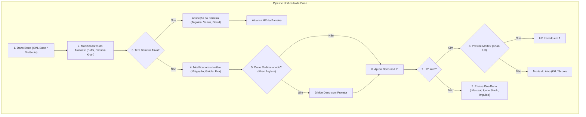

# Auditoria de Arquitetura: Transição para Heróis Orientados a Dados (Data-Driven)

**Data:** 03 de Outubro de 2026  
**Autor:** Antigravity  
**Tarefa Relacionada:** HERO-001 (`ai/TASKS.md`)  
**Status:** Análise Concluída (Somente Leitura — Nenhum arquivo de produção foi alterado)

---

## 1. Sumário Executivo

O objetivo desta auditoria é responder com precisão técnica à seguinte questão:  
> *Como modernizar a arquitetura do servidor e do cliente do Trigger Run para que o desenvolvimento seja mais ágil e desacoplado, abrindo caminho para balanceamentos rápidos e criação de novos heróis orientados a dados (inclusive gerados por LLMs), sem quebrar a gameplay atual?*

A investigação cobriu tanto a base de código do servidor Node.js (`src/socketServer.js`, `src/gameLogic.js`, `src/lamster.js`, `src/database.js`) quanto a base decompilada do cliente Unity (`Assembly/Assembly-CSharp/`) e os arquivos de configuração XML (`zh/`, `public/baxi/`).

### Principais Conclusões:
1. **O Cliente é Orientado a Dados (com limites de reflexão):**  
   O cliente Unity carrega classes de heróis e habilidades via reflexão C# (`Hero{heroclass}Me`, `{skillclass}Me`). Ele baixa as definições em XML diretamente do servidor/CDN via manifesto `files_dir.xml`. Portanto, **é 100% possível criar novos heróis ou balancear existentes sem recompilar a DLL do cliente**, desde que o novo herói reutilize classes de habilidades e modelos 3D/animators existentes no jogo (exatamente como foi feito com o Lamster ID 2000).
2. **O Servidor Está Fortemente Acoplado:**  
   No servidor, as mecânicas específicas de cada herói estão dispersas em blocos `if (heroId === ...)` ao longo de milhares de linhas em `src/socketServer.js` e `src/gameLogic.js`. Essa estrutura dificulta testes, introduz riscos de regressão e impede a criação dinâmica de personagens.
3. **Padrão de Primitivas Emergente:**  
   Quase todas as mecânicas exclusivas dos heróis atuais se resumem a cerca de **10 primitivas de efeito** (ex: *DamageMitigation*, *Lifesteal*, *DoTOnHit*, *DamageRedirection*, *BarrierShield*, *AuraHeal*, *Impulse/Knockback*, *AoERevive*).
4. **Solução Proposta:**  
   Implementar uma **Engine de Efeitos Genéricos** e um **Registro Declarativo de Heróis** (`data/heroes/*.json`). Um arquivo JSON por herói definirá seus atributos e pipelines de efeitos, permitindo que desenvolvedores ou LLMs criem heróis completos sem tocar no código central do servidor.

---

## 2. Auditoria do Cliente Unity (`Assembly-CSharp` e XMLs)

### 2.1 Fluxo de Carregamento de Configurações
- **Classes de Carga:** `loadConfig.cs`, `FbData.cs` e loaders específicos (`HeroUnlock.cs`, `HeroInfo.cs`).
- **XMLs Relevantes:**
  - `heroinfo.xml`: Define atributos básicos, ID, `heroclass`, referências a habilidades (`skillshow`), armas e som.
  - `herounlock.xml`: Mapeia ID do herói para strings de recursos visuais (`skinname`, `controller`, ícone, nome).
  - `playerskill.xml` & `heroskill.xml`: Define habilidades ativas (E/Shift), cooldown, alcance, efeitos e `skillclass`.
  - `dazhao.xml`: Define a Ultimate (custo de energia, raio de ação, dano, buffs acionados).
  - `weapon.xml`: Define cadência, dano base, velocidade de projétil, munição e tipo de disparo.
  - `buff.xml`: Define efeitos de status (stun, slow, invencibilidade, aumento de dano, escudo).
- **Entrega Hot-Delivery:**  
  O cliente lê `files_dir.xml` em `public/baxi/`. Qualquer alteração nos XMLs com atualização de CRC e versão faz o cliente baixar os novos dados no início da sessão HTTP, **sem necessidade de gerar novo executável**.

### 2.2 Fábrica por Reflexão e Restrições de Tipos
No código do cliente:
- `HeroPlayer.cs:374-387`:
  ```csharp
  string typeName = "Hero" + heroData.heroclass + "Me";
  Type type = Type.GetType(typeName);
  if (type == null) {
      type = typeof(HeroBaseMe);
  }
  this.heroCompent = (HeroBaseMe)base.gameObject.AddComponent(type);
  ```
- `GamePlayer.cs:1309-1340`: Executa a mesma reflexão para os demais jogadores (`"Hero" + heroclass + "It"`).
- `GamePlayer.cs:773-791`: Lê a lista `heroAllSkills` e adiciona componentes `{skillclass}Me` / `{skillclass}It`.

> [!WARNING]
> **Ponto Crítico de Fragilidade do Cliente:**  
> Nem todos os métodos de adicionar componente verificam nulidade antes de invocar `AddComponent`. Se um herói novo tentar usar um `heroclass` inexistente no código C#, o Unity pode falhar silenciosamente ou gerar exceção de componente nulo.  
> **Regra de Ouro:** Qualquer herói novo orientado a dados deve usar `heroclass = "0"` (que herda o padrão `HeroBaseMe`), ou reutilizar um `heroclass` existente que case com seu estilo de jogo.

### 2.3 Matriz de Viabilidade para Novos Heróis

| Cenário | O que muda | Onde atua | Viabilidade / Requisitos |
| :--- | :--- | :--- | :--- |
| **A. Rebalanceamento** | HP, dano, recarga, cooldown, raio | Server + XML | **100% Viável.** Atualização imediata via servidor e `public/baxi/`. |
| **B. Herói Remix (Kit Novo / Modelo Existente)** | Novo ID de herói, combinação de armas/skills existentes em modelo 3D existente | Server + XML | **100% Viável.** Comprovado com Lamster (ID 2000). Requer registro em `heroinfo.xml`, `herounlock.xml`, `weapon.xml`, etc. |
| **C. Herói Inédito (Novos Assets 3D/VFX)** | Malha 3D nova, animações exclusivas, efeitos sonoros novos | AssetBundles Unity | **Viável com modding de assets.** Requer exportar novos `.assetbundle` do Unity e catalogar em `files_dir.xml`. |
| **D. Herói com Mecânica C# Inédita** | Lógica de movimentação ou renderização nunca vista no jogo | `Assembly-CSharp.dll` | **Requer recompile de cliente.** Se a mecânica puder ser resolvida no servidor (ex: servidor empurra, servidor calcula vida), o cliente não precisa de alteração. |

---

## 3. Inventário da Lógica Hardcoded no Servidor

Atualmente, o servidor processa mecânicas específicas de heróis de forma espalhada. A tabela abaixo documenta todas as ocorrências encontradas no código:

| Herói / ID | Mecânica Hardcoded | Arquivo e Linhas | Descrição do Comportamento |
| :--- | :--- | :--- | :--- |
| **Tagaloa (1006)** | Barreira Direcional | `src/socketServer.js:6957-7010` | Escudo frontal de 8000 HP (`tagaloaShieldHp`), sincronizado via opcode `2010000`/`2010002`. Animações `JvDun` e `SheildState`. |
| **Tagaloa (1006)** | Regen Fora de Combate | `src/socketServer.js:7570-7591` | Se ficar 3s sem dano, recupera +350 HP/s na barreira no loop global de 1s. |
| **Venus (1032)** | Barreira Implantável | `src/socketServer.js:6963-7035` | Escudo posicionado no mapa (`venusBarrierHp`, 4000 HP), transmitido com coordenadas `(x, y, z)` e rotação. |
| **Lily (1033)** | Barreira Projetada | `src/socketServer.js:6967-7055` | Barreira com rotação transmitida via opcode `2210001`. |
| **Lily (1033)** | Repulsão M2 (Push) | `src/socketServer.js:7163-7220` | Arma 9985 ou shootname 2 aplica vetor de repulsão nos alvos. |
| **David (1037)** | Matriz Defensiva | `src/socketServer.js:6972-6985` | Absorve 100% do dano de projéteis frontais (barreira virtual de 10000 HP). |
| **Angel (1029)** | Cura Passiva em Área | `src/socketServer.js:7594-7625` | Cura 40 HP/s para todos os aliados em `angelAuraTargets` a cada segundo. |
| **Angel (1029)** | Tiro de Cura / Disparo | `src/socketServer.js:6837-6861` | Arma 1029 (shootname 3 ou 4) cura +400 HP ou +75 HP em aliados e gera carga de Ultimate. |
| **Angel (1029)** | Ressurreição em Massa (Ult) | `src/socketServer.js:4370-4415` | Itera aliados mortos num raio de 20m, cancela timer de respawn e envia `OnRevive`. |
| **Khan (1034)** | Ira de Sangue (Passiva) | `src/socketServer.js:6742-6755` | +1% de dano causado por ponto acumulado de `bloodAnger`. |
| **Khan (1034)** | Asilo / Redirecionamento | `src/socketServer.js:6912-6930` | Buff 1043 transfere 50% do dano tomado pelo protegido para o Khan. |
| **Khan (1034)** | Imortalidade de Ferro (Ult) | `src/socketServer.js:7114-7123` | Buffs 1046/1047 impedem que o HP caia abaixo de 1 durante a duração. |
| **Nezha (1035)** | Fúria Divina (Ult) | `src/socketServer.js:6756-6777` | Buffs 1049/1050/1051: +50% dano causado, -40% dano sofrido. |
| **Vincent (1030)** | Duelo Noturno (Ult) | `src/socketServer.js:6779-6800` | Buffs 1033/1039/1040: +50% dano causado, -40% dano sofrido. |
| **Medusa / Gaya (1036)** | Olhar Petrificante (Ult) | `src/socketServer.js:6803-6813` | Buff 1055: -80% de dano sofrido. |
| **Dragos (1026)** | Lifesteal Vampírico (Ult) | `src/socketServer.js:7147-7157` | Durante Buff 1023 ou shootname 4, cura 35% do dano causado diretamente no atacante. |
| **Jack (1027)** | Investida Tempestade | `src/socketServer.js:6815-6820` | Arma 1027/1102 shootname 3 aplica Stun (Buff 1024) por 1000ms no alvo atingido. |
| **Glider (1005)** | Escalonamento de Dano (Ult) | `src/socketServer.js:6821-6835` | Dano escala com o tempo de mira contínua até 4200. |
| **Loki (1028)** | Absorção de Escudo | `src/socketServer.js:6881-6897` | Habilidade 1112 converte dano recebido em carga de arma via opcode `2050001`. |
| **Loki (1028)** | Dinamite Remota | `src/socketServer.js:7184-7220` | Arma 9990 ou NPC 1019 aplica repulsão física em área. |
| **Brigit (1023)** | Passiva Queimadura (Ignite) | `src/socketServer.js:7126-7145` | 3 hits em 3s (da heroína ou torreta) aplicam DoT Buff 1017 (4x50 = 200 de dano). |
| **Shogun (1024)** | Flecha Repulsora | `src/socketServer.js:7172-7183` | Arma 1024 com launcherNo 1 aplica repulsão e dano calibrado. |
| **Shogun (1024)** | Rocket Jump nos Pés | `src/socketServer.js:6867-6879`, `7192-7200` | Se atirar no chão nos próprios pés, dano é anulado e aplica impulso vertical 2400. |
| **Johnny (1021)** | Mina / Torreta Giratória | `src/socketServer.js:6906-6910` | Trap NPC 1021 fica invulnerável a dano enquanto ativa/girando. |
| **Carmen (1021)** | Feixe de Cura e Farol | `src/socketServer.js:7522-7530`, `gameLogic.js:1081-1088` | Limpeza de Buffs 1021, 1005, 1010 ao desconectar ou trocar de herói. |
| **Eva (1025)** | Gaiola Eletrostática | `src/socketServer.js:6932-6935` | Reduz dano de atacantes de fora que estejam contidos em 25%. |
| **Lamster (2000)** | Suporte e Cura | `src/lamster.js:1-49` | Feixes de cura 180 HP/s e 360 HP pulse, com auto-cura de 25% até 45 HP. |
| **Geral (HP Máximo)** | Tabela Hardcoded de HP | `src/database.js:726-755` | `getHeroMaxHp`: switch para 25 heróis; padrão 2000 HP. |
| **Geral (Recargas)** | Durações de Recarga | `src/socketServer.js:3733-3745` | Mapeamento manual de ms por herói (Lars 2000ms, Carmen 1500ms, etc.). |
| **Geral (Bots PvE/TDM)** | Mapeamento de Crieção | `src/gameLogic.js:930-960` | `getValidRobotCreateIndex`: switches rígidos baseados em mapa e herói. |

---

## 4. O Sistema de Primitivas de Efeitos (Generic Effect Engine)

Ao analisar a lista acima, fica claro que a lógica não precisa de código sob medida para cada herói. Todas as interações derivam de uma combinação das seguintes **Primitivas de Efeito**:



### Catálogo de Primitivas Propostas:
1. `DamageModifier`: Altera dano causado ou recebido percentualmente com base em buffs ou atributos (Nezha, Vincent, Medusa, Eva, Khan).
2. `BarrierShield`: Escudo com HP próprio, que pode ser corporal/direcional (Tagaloa), implantado no mundo (Venus) ou absorvedor total (David). Suporta regeneração periódica fora de combate.
3. `DamageRedirection`: Divide ou transfere dano recebido para outra entidade aliada vinculada (Khan Asylum).
4. `Lifesteal`: Converte uma porcentagem do dano real causado em cura direta para o atacante (Dragos).
5. `HitCounterTrigger`: Acumula acertos dentro de uma janela temporal para disparar um buff/efeito secundário (Brigit Ignite).
6. `ImpulseKnockback`: Aplica vetor de deslocamento físico no alvo ou no próprio atacante (Lily M2, Shogun repulsão, Shogun rocket jump, Loki bomba).
7. `DeathPrevention`: Impede que a vida caia abaixo de um limiar durante a vigência de certos estados (Khan Iron Immortality).
8. `AuraInterval`: Executa um efeito de cura ou dano a cada `X` ms em aliados ou inimigos num raio determinado (Angel Aura, Lamster).
9. `AoEResurrect`: Busca entidades derrotadas na mesma equipe dentro de um raio e restabelece vida e estado ativo (Angel Ult).
10. `AbsorbToMeter`: Converte dano mitigado em pontos de recurso/munição (Loki).

---

## 5. Proposta de Arquitetura: Heróis Orientados a Dados (Data-Driven)

Para possibilitar que desenvolvedores e **LLMs** criem personagens completos sem alterar arquivos sensíveis de execução (`socketServer.js`), propõe-se a seguinte estrutura:

### 5.1 Nova Estrutura de Diretórios
```text
server-tr/
├── data/
│   └── heroes/                 <-- Um JSON por herói
│       ├── 1006_tagaloa.json
│       ├── 1026_dragos.json
│       ├── 1029_angel.json
│       ├── 1034_khan.json
│       ├── 2000_lamster.json
│       └── 3001_novo_heroi.json
├── src/
│   ├── effects/                <-- Primitivas puras e testáveis
│   │   ├── damagePipeline.js
│   │   ├── barrierEngine.js
│   │   ├── auraEngine.js
│   │   └── impulseEngine.js
│   └── heroRegistry.js         <-- Carregador e validador de definições
```

### 5.2 Exemplo de Definição Declarativa: `data/heroes/1026_dragos.json`
```json
{
  "id": 1026,
  "name": "Dragos",
  "archetype": "assassin",
  "clientClass": "Hero0Me",
  "baseStats": {
    "maxHp": 1000,
    "shieldHp": 0,
    "reloadDurationMs": 1600
  },
  "effects": {
    "onDamageDealt": [
      {
        "type": "Lifesteal",
        "condition": {
          "anyBuffActive": [1023],
          "orShootName": "4"
        },
        "ratio": 0.35,
        "logTag": "DRAGOS BLOODTHIRSTY LIFESTEAL"
      }
    ]
  }
}
```

### 5.3 Exemplo de Herói Híbrido/Criado por LLM: `data/heroes/3001_paladino.json`
```json
{
  "id": 3001,
  "name": "Paladino",
  "archetype": "tank_support",
  "clientClass": "0",
  "baseStats": {
    "maxHp": 1800,
    "shieldHp": 500,
    "reloadDurationMs": 1800
  },
  "barrier": {
    "type": "directional",
    "maxHp": 4000,
    "outOfCombatRegen": {
      "delayMs": 4000,
      "ratePerSecond": 250
    }
  },
  "aura": {
    "intervalMs": 1000,
    "targetTeam": "ally",
    "range": 500,
    "healPerTick": 25
  },
  "effects": {
    "onDamageDealt": [
      {
        "type": "Lifesteal",
        "ratio": 0.15
      }
    ]
  }
}
```

---

## 6. Roteiro de Migração sem Regressão (Phased Migration Plan)

Para garantir máxima estabilidade e conformidade com as diretrizes do projeto (`AGENTS.md` e `STATE.md`), a implementação deve ocorrer em fases com testes automatizados antes de qualquer deploy:

### Fase 1: Isolamento de Leitura e Estatísticas (Baixo Risco)
- Extrair `getHeroMaxHp` e `HERO_RELOAD_DURATIONS` para o novo registro central `heroRegistry.js`.
- Alimentar os dados a partir de arquivos JSON em `data/heroes/`.
- **Critério de Aceitação:** Testes existentes de lifecycle e servidor continuam 100% verdes.

### Fase 2: Engine de Dano e Barreiras (Médio Risco)
- Migrar Tagaloa, Venus, David e Loki para usar o `barrierEngine.js`.
- O pipeline de dano em `socketServer.js:6800-7200` passa a invocar `damagePipeline.processHit(...)`, que avalia as regras cadastradas no JSON do herói.
- **Critério de Aceitação:** Batalha de teste com Tagaloa e Khan reproduz exatamente a mesma absorção, regeneração e redirecionamento de antes.

### Fase 3: Auras e Intervalos Periódicos (Médio Risco)
- Unificar o intervalo de 1s de cura da Angel e Tagaloa sob um loop de auras genéricas.
- Incorporar o Lamster (`src/lamster.js`) como definição orientada a dados.
- **Critério de Aceitação:** `tests/lamster.test.js` passa sem necessidade de manter lógica ad-hoc em `socketServer.js`.

### Fase 4: Tooling para LLMs e Sincronização de XMLs (Inovação)
- Criar script `tools/generate-hero.cjs`:
  - Recebe um JSON de herói.
  - Valida parâmetros (garante que `clientClass` e armas sejam compatíveis com o cliente).
  - Gera/atualiza automaticamente as entradas nos XMLs em `public/baxi/` (`heroinfo.xml`, `weapon.xml`, etc.) e recalcula o hash em `files_dir.xml`.
- **Critério de Aceitação:** Um novo herói criado por IA pode ser jogado no cliente real imediatamente após o reinício do servidor, sem escrever uma única linha de código C# ou Node.js.

---

## 7. Próximos Passos Imediatos
1. Liberar a tarefa `HERO-001` no quadro `ai/TASKS.md`.
2. Quando aprovado pelo usuário, propor a tarefa `DATA-001` para implementar a Fase 1 (extração do Registro Declarativo de Estatísticas e HP).
